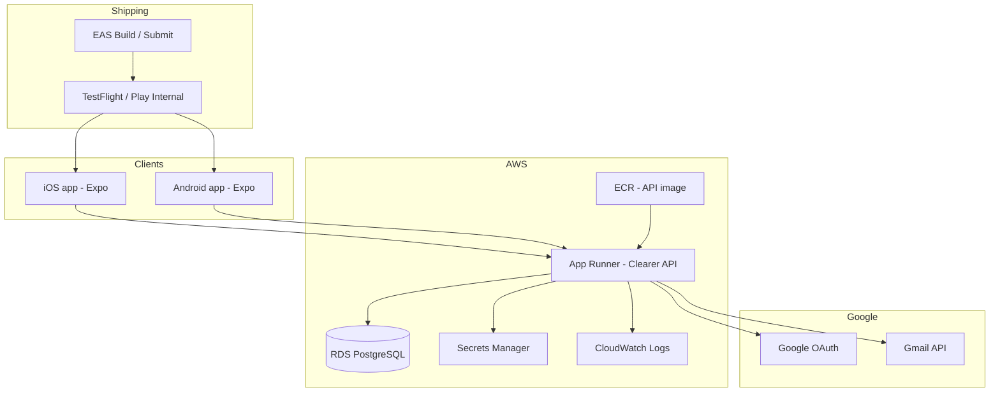
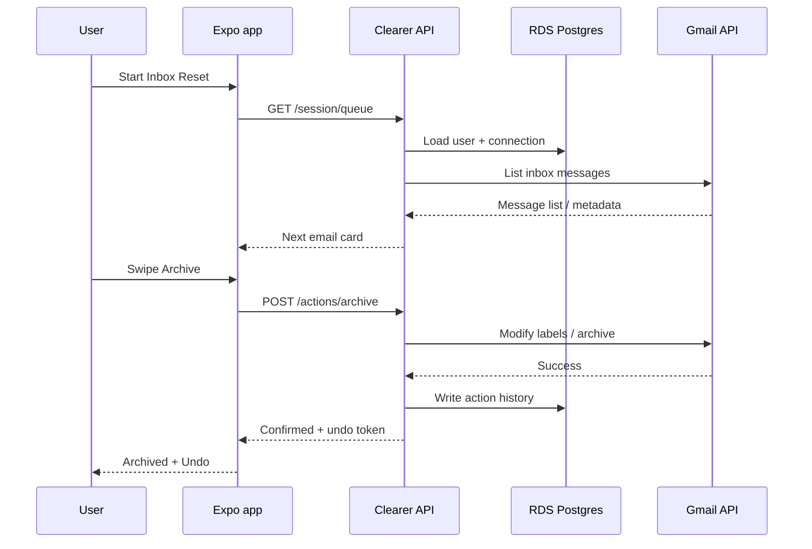
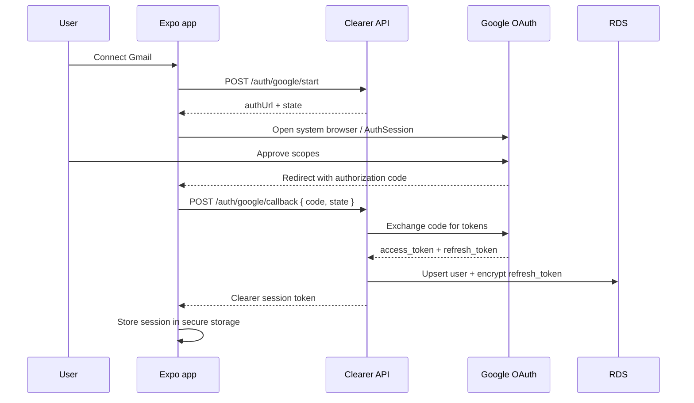
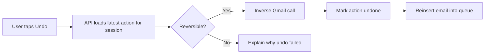
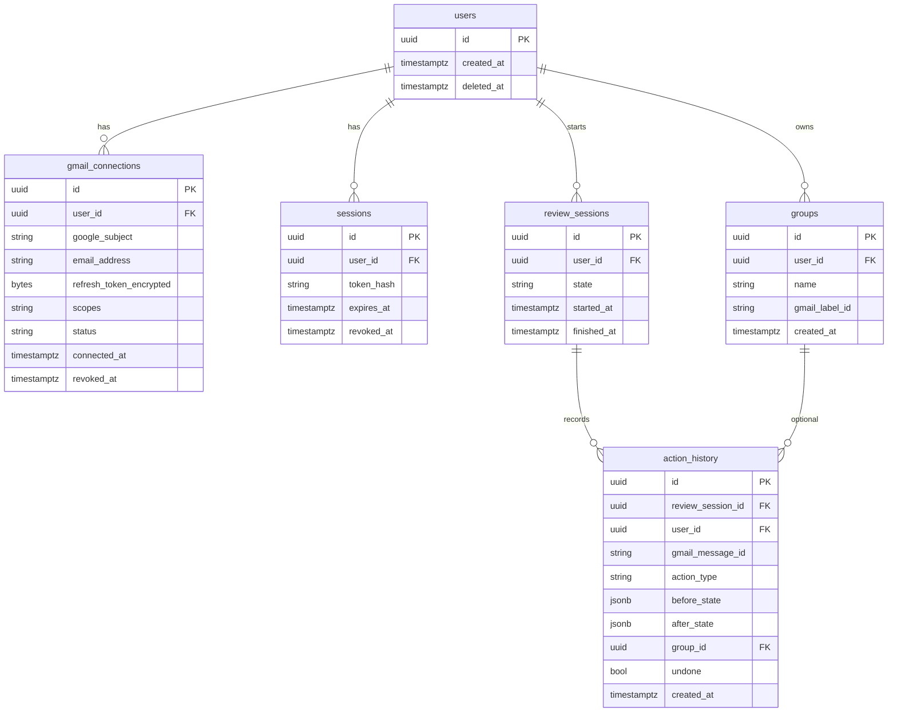
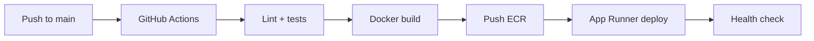
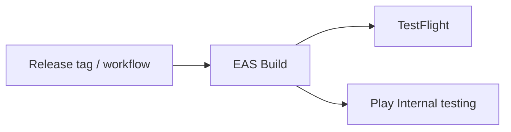

# The Clearer Technical Architecture

The [Product Requirements](./product-requirements.md) define **what** we are building.

This document defines **how** we build it.

It covers the technology stack, system architecture, authentication, data model, Gmail integration, deployment on AWS, and the operational practices that keep Clearer simple to maintain and debug.

The guiding constraint is the same as the product:

> Prefer the simplest architecture that does not skip important steps.

---

## 1. Architecture Goals

The MVP architecture must:

1. **Support the Inbox Reset experience** — connect Gmail, review one email at a time, apply Keep / Archive / Delete / Organise, undo, and finish a session.
2. **Stay easy to deploy and operate** — few moving parts, clear logs, predictable deploys.
3. **Run on AWS** — without adopting a full AWS platform (no EKS, no Lambda spaghetti, no Cognito-first design).
4. **Protect email access** — OAuth only, encrypted token storage, minimum scopes, no Gmail passwords.
5. **Keep humans in control** — the API applies actions only after an explicit user decision.
6. **Leave room to grow** — Outlook and non-email declutter can arrive later without a rewrite.

### What we optimise for

| Priority | Meaning |
| --- | --- |
| Clarity | One API, one database, one mobile client |
| Debuggability | One place for API logs; reproducible local setup |
| Trust | Tokens encrypted; email bodies not logged; disconnect works |
| Speed to learn | Ship the swipe loop before AI complexity |

### What we deliberately avoid in MVP

- Kubernetes / EKS
- Lambda + API Gateway as the primary API
- Cognito as the primary identity system
- Multi-region active-active
- Full offline Inbox Reset
- A browser web app
- Self-managed email infrastructure

---

## 2. High-Level Architecture

Clearer has three runtime pieces:

1. **Mobile app** — Expo (React Native) for iOS and Android
2. **API** — Node.js / TypeScript service on AWS App Runner
3. **Database** — PostgreSQL on Amazon RDS

Google (Gmail OAuth + Gmail API) is an external dependency. Secrets live in AWS Secrets Manager. Mobile binaries are built with Expo Application Services (EAS), not AWS.

### Request path (happy path)

---

## 3. Technology Stack

| Layer | Choice | Why |
| --- | --- | --- |
| Mobile | **Expo (React Native) + TypeScript** | One codebase for iOS and Android; fast iteration; EAS for builds |
| API | **Node.js + TypeScript** (Hono or equivalent thin framework) | Same language as the app; small surface area; easy to containerise |
| Database | **PostgreSQL on Amazon RDS** | Relational model fits users, sessions, action history; inspectable |
| Hosting | **AWS App Runner** | Deploy a container; HTTPS and scaling without VPC/ECS ceremony |
| Images | **Amazon ECR** | Source of truth for API images App Runner pulls |
| Secrets | **AWS Secrets Manager** | Google client secret, DB credentials, token encryption key |
| Logs | **CloudWatch Logs** | Default App Runner logging destination |
| Mobile CI/CD | **EAS Build + EAS Submit** | Official Expo path to TestFlight and Play Console |
| API CI/CD | **GitHub Actions → ECR → App Runner** | Build, push, deploy on merge to main |
| Docs | **Docusaurus on Vercel** | Already established; separate from the product runtime |

### Repository layout (intended)

| Repo | Purpose |
| --- | --- |
| `clearer-app` | Expo mobile client |
| `clearer-api` (or `clearer-app/apps/api` if monorepo later) | Node/TypeScript API |
| `clearer-docs` | This documentation site |

Starting with separate repos is fine. A monorepo may be adopted later if shared types become valuable. Shared TypeScript types for API contracts should exist either as a small package or duplicated carefully at first — prefer a shared `contracts` package once the API stabilises.

### Why not other common options

| Option | Decision |
| --- | --- |
| Flutter | Viable, but Expo keeps us in TypeScript end-to-end |
| Native iOS + Android | Too much duplicate work for MVP |
| Lambda-first API | Harder to reason about long OAuth + Gmail flows; more AWS glue |
| Cognito | Unnecessary when Google OAuth for Gmail is the real identity gate |
| DynamoDB | Action history and relational joins are simpler in Postgres |
| Railway / Render | Simpler than AWS, but this architecture intentionally stays on AWS |

---

## 4. System Components

### 4.1 Mobile app (`clearer-app`)

Responsibilities:

- Onboarding, connect Gmail, Inbox Reset UI, organise/groups, settings
- Swipe and visible button equivalents for all four actions
- Local session UX state (current card, optimistic feedback)
- Secure storage of the **Clearer session token** (not the Gmail refresh token)
- Calling the Clearer API for all Gmail-affecting operations

The app must **not**:

- Store Gmail refresh tokens long-term as the system of record
- Call Gmail APIs directly for write actions in MVP (keeps audit, undo, and confirmation in one place)
- Log email bodies or subject lines to analytics

Read-only Gmail access from the device is also discouraged in MVP so that permissions, retries, and confirmation stay centralised in the API.

### 4.2 Clearer API

Responsibilities:

- Google OAuth start/callback and token lifecycle
- Issuing and validating Clearer sessions
- Fetching and shaping the review queue from Gmail
- Applying Keep / Archive / Delete / Organise
- Undo via action history
- Groups ↔ Gmail labels mapping
- Disconnect and account deletion workflows
- Privacy-safe product analytics events (optional in early MVP)

The API is the only component that holds Gmail refresh tokens.

### 4.3 PostgreSQL

Stores:

- Clearer users and sessions
- Connected Gmail accounts (encrypted tokens)
- Groups metadata (linked to Gmail label IDs)
- Action history for undo and session summaries
- Minimal preference / learning signals (when AI is enabled)
- Privacy-safe analytics aggregates if needed

Does **not** store full email bodies by default.

### 4.4 External systems

| System | Use |
| --- | --- |
| Google OAuth | User authorises Clearer |
| Gmail API | List messages, get metadata/snippet, modify labels, trash, mark read |
| EAS | Produce store-ready binaries |
| App Store / Play Console | Distribution |

---

## 5. Authentication & Sessions

Clearer uses **two layers** of auth:

1. **Google OAuth** — proves the user owns the Gmail account and grants API scopes
2. **Clearer session** — proves the mobile app is acting for that user against our API

We do **not** use Cognito for MVP.

### 5.1 OAuth flow

### 5.2 Required Google behaviour

- Use Google's official OAuth for mobile (Auth Session / AppAuth-style flow via Expo)
- Request **minimum scopes** needed for Inbox Reset (exact scope list confirmed before build; see §14)
- Never ask for or store the user's Gmail password
- Store `refresh_token` encrypted at rest (envelope encryption with key from Secrets Manager)
- Refresh access tokens on the API; never expose refresh tokens to the client
- On disconnect: revoke Google token where supported, delete encrypted tokens, invalidate Clearer sessions

### 5.3 Clearer session

- Opaque session token or signed JWT (prefer opaque server-side sessions for easy revocation)
- Stored on device in the platform secure store
- Short idle lifetime with refresh, or rotating sessions
- Invalidated on logout, disconnect, or account deletion

---

## 6. Inbox Reset Runtime

### 6.1 Queue construction

When a session starts:

1. API verifies Clearer session and active Gmail connection
2. API lists inbox messages via Gmail API
3. API builds a review queue:
   - Unread first
   - Then optional read queue only after the user opts in
4. API returns one email card at a time (or a small prefetch window of 1–3 cards)

Each card includes at minimum:

- Provider message ID
- Sender
- Subject
- Date/time
- Snippet / preview suitable for decision-making
- Read/unread state
- Optional classification hint (when AI is enabled)

Full MIME bodies are fetched only when needed for a richer preview — not bulk-persisted.

### 6.2 Actions

| User action | Gmail effect | Notes |
| --- | --- | --- |
| **Keep** | Remains in inbox; mark read if unread | No content change |
| **Archive** | Remove `INBOX` (native archive) | Must match Gmail archive behaviour |
| **Delete** | Move to Trash | Never permanent delete by Clearer |
| **Organise** | Apply Gmail label for selected group; then leave review queue | Email belongs to 0 or 1 Clearer group |

Every successful action:

1. Is confirmed by Gmail (or clearly failed)
2. Is written to `action_history`
3. Returns an undo handle to the client
4. Advances the queue

Failed actions must never be shown as successful.

### 6.3 Undo

Inverse mapping:

| Original | Undo |
| --- | --- |
| Keep (marked read) | Mark unread again when that was the prior state |
| Archive | Re-add `INBOX` |
| Delete | Move from Trash back to Inbox |
| Organise | Remove the applied Clearer group label |

The UI may expose only “undo last”, but the API keeps a history so multiple undos remain possible.

### 6.4 Session summary

On finish, the API aggregates action history for the session:

- Reviewed count
- Archived / deleted / organised / kept counts
- Remaining unread estimate if available

Summaries use counters and IDs — not email bodies.

---

## 7. Groups & Gmail Labels

Clearer groups are a product concept mapped to **Gmail labels**.

| Clearer concept | Gmail representation |
| --- | --- |
| Group | User label |
| Assign to group | Add label to message |
| Create group | Create label |
| Remove Clearer organisation | Remove that label |

Rules for MVP:

- An email may belong to **zero or one** Clearer group
- Labels created in Clearer remain visible in Gmail
- On first connect, existing Gmail labels may be imported as available groups (product decision; default proposal: **import user labels as selectable groups**, do not auto-assign)
- Renames/deletes in Gmail should be reconciled on next sync; Clearer must not invent a parallel taxonomy that traps the user

---

## 8. Data Model

Minimal relational model for MVP:

### Storage principles

- Prefer **IDs + metadata** over full email content
- Cache message metadata briefly for the active session if needed; TTL should be short
- Encrypt refresh tokens and any other secrets at the application layer
- On account deletion: delete Clearer rows; leave Gmail mailbox intact
- On disconnect: revoke tokens; keep only what is required for legal/security audit (documented retention)

---

## 9. API Surface (MVP)

Illustrative REST-style surface. Exact paths may change; behaviour must not.

### Auth

| Method | Path | Purpose |
| --- | --- | --- |
| `POST` | `/auth/google/start` | Begin OAuth; return URL + state |
| `POST` | `/auth/google/callback` | Exchange code; create session |
| `POST` | `/auth/logout` | Revoke Clearer session |
| `GET` | `/me` | Current user + connection status |

### Inbox Reset

| Method | Path | Purpose |
| --- | --- | --- |
| `POST` | `/reset/start` | Create review session; build queue |
| `GET` | `/reset/current` | Current email card + progress |
| `POST` | `/reset/actions/keep` | Keep |
| `POST` | `/reset/actions/archive` | Archive |
| `POST` | `/reset/actions/delete` | Trash |
| `POST` | `/reset/actions/organise` | Apply group/label |
| `POST` | `/reset/actions/undo` | Undo last reversible action |
| `POST` | `/reset/finish` | Complete session; return summary |
| `POST` | `/reset/continue-read` | Opt in to read queue after unread complete |

### Groups & account

| Method | Path | Purpose |
| --- | --- | --- |
| `GET` | `/groups` | List groups |
| `POST` | `/groups` | Create group (+ Gmail label) |
| `DELETE` | `/groups/:id` | Delete Clearer group mapping / label policy TBD |
| `POST` | `/account/disconnect` | Disconnect Gmail |
| `POST` | `/account/delete` | Delete Clearer account data |

All mutating routes require a valid Clearer session. Responses must distinguish:

- **Confirmed** — Gmail accepted the change
- **Failed** — nothing changed / uncertain; client must not celebrate success

---

## 10. AI Architecture (MVP Stance)

Product rule remains:

> AI suggests. Humans decide.

### MVP recommendation

**Ship the Inbox Reset loop without AI first**, then add recommend-only assistance.

Phase A (required for product proof):

- Deterministic queueing (unread → optional read)
- Optional simple heuristics (e.g. list-unsubscribe header, known promotional patterns) without an LLM

Phase B (optional soon after):

- Classification / recommendation service called by the API
- Returns labels like “might be a newsletter” with explanation text
- Never auto-applies Archive / Delete / Organise

If an LLM provider is introduced:

- Send **minimised** payloads (sender domain, subject, snippet) — not entire mailboxes
- Disable provider training on customer content contractually and technically where possible
- Do not log prompts that contain email content to shared debug tools
- Document the provider in this architecture when chosen

AI is an assistant to the decision loop, not a second product.

---

## 11. Security & Privacy Controls

These are the technical controls that implement the PRD’s trust requirements.

| Control | Implementation |
| --- | --- |
| No passwords | Google OAuth only |
| Minimum scopes | Confirmed scope set before production OAuth consent |
| Token storage | Refresh tokens encrypted; key in Secrets Manager |
| Transport | HTTPS everywhere (App Runner TLS; mobile ATS / network security config) |
| Least privilege IAM | App Runner instance role limited to Secrets Manager + CloudWatch (+ ECR pull) |
| No body logging | Structured logs omit subjects, snippets, and bodies |
| Action confirmation | Success only after Gmail acknowledges |
| Disconnect | Revoke + delete tokens + invalidate sessions |
| Account deletion | Delete Clearer personal data; never delete the Gmail account |
| Analytics | Event names and counters only; no email content |

Detailed legal/privacy policy language may live in a future Trust & Privacy document. **This architecture is the source of truth for technical behaviour.**

---

## 12. AWS Deployment

### 12.1 Environments

| Environment | Purpose |
| --- | --- |
| `local` | Expo + API on developer machine; Postgres via Docker or shared dev RDS |
| `staging` | App Runner + RDS; TestFlight / internal Play builds point here |
| `production` | App Runner + RDS; store releases |

Separate AWS accounts for staging and production are preferred when practical; at minimum, separate App Runner services, RDS instances, and secrets.

### 12.2 App Runner service

- Container listens on a single HTTP port
- Health check on `GET /health`
- Environment variables for non-secret config (`NODE_ENV`, Google client ID, redirect URIs)
- Secrets injected from Secrets Manager (DB URL, Google client secret, token encryption key)
- Autoscaling within a small range for MVP

### 12.3 RDS

- PostgreSQL, smallest instance class that is reliable
- Private access pattern preferred (App Runner VPC connector when enabled)
- Automated backups on
- Migrations run as part of deploy (e.g. Prisma / Drizzle / node-pg migrate) before traffic shift

### 12.4 CI/CD

Mobile:

### 12.5 Domains

- API: `api.useclearer.com` (or staging subdomain)
- Docs: existing docs host (Vercel / `docs.useclearer.com`)
- OAuth redirect URIs registered for each environment

### 12.6 Cost posture

MVP should stay on small App Runner + small RDS. Turn off unused staging resources when idle if cost matters. Avoid idle large instances.

---

## 13. Observability & Debugging

### What we monitor

- Auth success / failure rates
- Gmail API error rates and latency
- Action confirmation failures
- Undo failures
- API 5xx rate
- App Runner instance health
- RDS CPU / storage / connections

### How we debug

1. Reproduce against `local` with a test Gmail account
2. Inspect CloudWatch logs for the App Runner service (request ID correlation)
3. Inspect `action_history` for the affected session
4. Never paste email content into public issue trackers

### Privacy-safe analytics events (product)

Aligned with the PRD:

- Onboarding started
- Gmail connected
- Inbox Reset started
- Email reviewed (count only)
- Action selected (type only)
- Undo used
- Group created
- Inbox Reset completed
- User returned

No subjects, senders, or bodies.

---

## 14. Decisions Locked for MVP

| Decision | Choice |
| --- | --- |
| Platforms | iOS + Android via Expo |
| Backend | Single Node/TypeScript API |
| Cloud | AWS |
| Compute | App Runner |
| Database | RDS PostgreSQL |
| Secrets | Secrets Manager |
| Identity | Google OAuth + Clearer sessions (no Cognito) |
| Gmail writes | API-mediated only |
| Delete semantics | Provider Trash only |
| Groups | Map to Gmail labels |
| AI | Optional Phase B; not required to prove the loop |
| Web app | Out of scope |

### Scope list (to confirm before production OAuth)

Exact Google scopes must be chosen as the minimum set that allows:

- Read inbox message metadata and content needed for review
- Modify message labels (archive / organise)
- Move messages to Trash
- Mark read / unread for Keep / Undo

The live scope strings should be recorded here once confirmed in Google Cloud Console. Until then, treat scopes as an open implementation checklist item — not an invitation to request broad Gmail access.

---

## 15. Explicitly Deferred

| Item | When to reconsider |
| --- | --- |
| Outlook provider | After Gmail MVP validates the loop |
| Cognito / social login beyond Gmail | If Clearer accounts exist without mailbox connect |
| Lambda workers / SQS | If classification or sync jobs need async scale |
| ElastiCache | If queue construction needs shared caching |
| Multi-region | Only with clear latency or resilience need |
| Full offline mode | Not required by PRD |
| Kubernetes | If App Runner limits are actually hit |
| Dedicated AI VPC / Bedrock | When Phase B AI is designed |
| Trust & Privacy legal doc | Parallel to launch readiness |

---

## 16. Local Development

Target developer loop:

1. Start Postgres (Docker Compose)
2. Start API (`pnpm dev` / `npm run dev`) with `.env` pointing at local DB and Google OAuth web/desktop test client
3. Start Expo (`npx expo start`)
4. Use a dedicated Google Cloud OAuth client for development redirect schemes
5. Use a throwaway Gmail account for testing destructive actions

Document concrete commands in each repo README when scaffolding begins. This architecture owns the shape; READMEs own the keystrokes.

---

## 17. Mapping to Product Requirements

| PRD area | Architecture coverage |
| --- | --- |
| Connect Gmail | §5 Authentication |
| Inbox review + swipe actions | §6 Inbox Reset Runtime |
| Undo | §6.3 |
| Groups | §7 |
| Session summary / persistence | §6, §8 |
| Trust & security behaviour | §11 |
| Mobile iOS/Android | §3, §4.1 |
| No web MVP | §1, §14 |
| AI suggests only | §10 |
| Out of scope automation | Enforced by API never acting without user intent |

If a proposed technical change conflicts with the PRD, the PRD wins unless product intentionally revises it.

---

## 18. Open Technical Questions

These remain visible on purpose.

1. Exact Gmail OAuth scope strings for production
2. Whether App Runner VPC connector is required from day one for RDS (recommended yes for production)
3. Opaque sessions vs JWT for Clearer auth
4. ORM / migration tool (Prisma vs Drizzle vs SQL)
5. Prefetch window size for email cards
6. Whether existing Gmail labels auto-import as groups on first connect
7. Whether Phase B AI uses a third-party LLM or Amazon Bedrock
8. Minimum iOS and Android versions (product + store policy)

None of these block writing the first scaffolding PRs, except **OAuth scopes**, which must be fixed before a production Google consent screen.

---

## 19. Implementation Order

Suggested build sequence for `clearer-app` and the API:

1. Scaffold Expo app + App Runner API hello-world on AWS staging
2. Postgres schema + migrations for users / sessions / connections
3. Google OAuth connect + disconnect
4. List inbox + present one email card
5. Archive / Delete / Keep against Gmail with confirmation semantics
6. Action history + Undo
7. Organise + Create group → Gmail labels
8. Unread complete + optional read queue + session summary
9. Settings, account deletion, privacy copy in-product
10. EAS → TestFlight / Play internal
11. Optional Phase B recommendations

Do not start with AI, analytics dashboards, or multi-provider abstractions.

---

## Summary

Clearer’s MVP runs as:

> **Expo app → Clearer API on App Runner → RDS Postgres → Gmail API**

with secrets in Secrets Manager and mobile shipping via EAS.

That is the simplest AWS-shaped system that still does the important things properly: real OAuth, encrypted tokens, confirmed actions, undo, disconnect, and a maintainable deploy path.

**Five minutes. A clearer digital life.**
